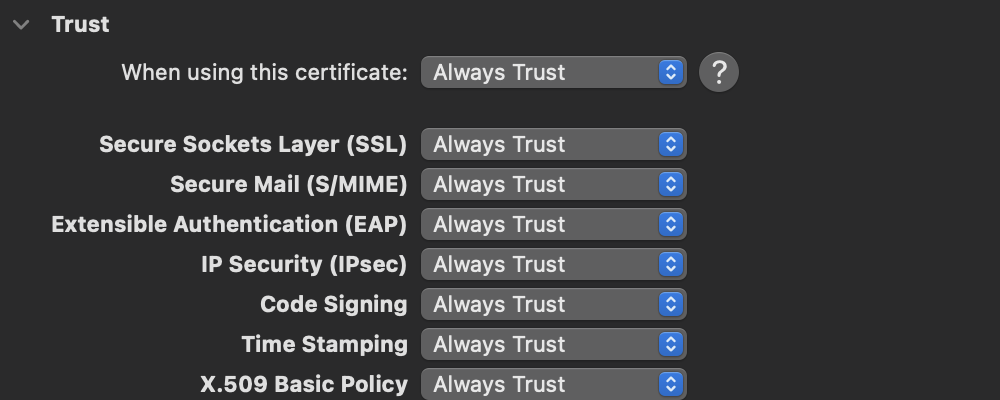

# iOS 설정

iOS에 보내는 인증서는 만든 인증서가 아니라 Root CA 를 보내야 한다.

```bash
mkcert -CAROOT # 경로 나옴
open $(mkcert -CAROOT) # 경로 열기

# 해당 경로의 pem 파일을 iOS에 AirDrop 으로 보냄
# 설치를 완료하고,
# [설정 → 일반 → 정보 → 인증서 신뢰 설정]에 들어가서 인증서 신뢰 활성화
```
# Node.js 에서 사용

```bash
NODE_EXTRA_CA_CERTS="(mkcert -CAROOT)/rootCA.pem" node test.mjs
```

Server나 다른 쪽에서 사용하려는 경우, 먼저 파일을 옮겨줘야 한다.

```bash
scp (mkcert -CAROOT)/rootCA.pem <user>@<server-ip>:~/Certifications/
```

# mkcert -CAROOT 경로를 찾을 수 없는 경우

mkcert 정보가 삭제되었을때?

1. `~/Certifications` 디렉토리에 있는 rootCA.pem 파일 찾음 (없으면 서버에서)
2. AirDrop 으로 아이폰에 보냄
3. 설치
4. [설정 → 일반 → 정보 → 인증서 신뢰 설정]에 들어가서 인증서 신뢰 활성화

# 인증서 만료 대처

1. `~/Certifications` 에서 `mkcert localhost 127.0.0.1 <server-ip>` 로 인증서 만듬
2. `cp (mkcert --CAROOT)/rootCA.pem ./rootCA.pem` 으로 복사
3. `scp ./rootCA.pem <user>@<server-ip>:~/Certifications/` 서버로 전송
4. macOS 상에서 Trust 처리
    
    
    
5. AirDrop 으로 보내고 설치, 인증서 신뢰 설정